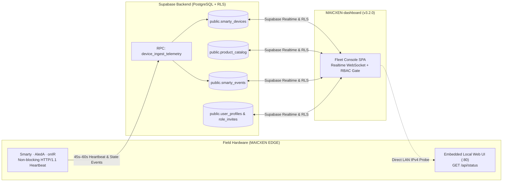

<div align="center">

# MAICXEN EDGE — Enterprise Fleet Console (`MAICXEN-dashboard`)

**Real-Time IoT Fleet Observability (`v3.2.0`) · Invite-Only RBAC · Unified Product Catalog Governance · LAN IPv4 Discovery · Supabase PostgreSQL + RLS**

[-2997ff?style=for-the-badge&logo=shield&logoColor=white)](https://iot.maicxen.it/dashboard/)
[](https://github.com/MAICXEN-STUDIOS/MAICXEN-dashboard)
[-0a84ff?style=for-the-badge&logo=googlechrome&logoColor=white)](https://iot.maicxen.it/)
[](https://supabase.com/)

*Engineered by **MAICXEN EDGE***

</div>

---

## Table of Contents

1. [Overview & Standalone Repository Role](#1-overview--standalone-repository-role)
2. [Cloud Telemetry & Security Architecture](#2-cloud-telemetry--security-architecture)
3. [Console Workspaces & Capabilities](#3-console-workspaces--capabilities)
4. [Invite-Only Role-Based Access Control (RBAC)](#4-invite-only-role-based-access-control-rbac)
5. [Automated Synchronization & Deployment](#5-automated-synchronization--deployment)
6. [Directory Structure](#6-directory-structure)

---

## 1. Overview & Standalone Repository Role

`MAICXEN-dashboard` (`EDGE/Tools/MAICXEN-dashboard`) is the standalone repository (`https://github.com/MAICXEN-STUDIOS/MAICXEN-dashboard.git`) for the **MAICXEN EDGE Enterprise Fleet Console (`v3.2.0`)**, deployed at [`https://iot.maicxen.it/dashboard/`](https://iot.maicxen.it/dashboard/).

It is completely self-contained (`index.html` at the repository root with local `./css/`, `./js/`, and `./shared/` modules) so it can be served standalone or mounted under `/dashboard/` on `iot.maicxen.it`.

---

## 2. Cloud Telemetry & Security Architecture



---

## 3. Console Workspaces & Capabilities

1. **Devices (`#sec-devices`)**:
   - **Hairline KPI Bar**: Live clickable counters for `Total Devices`, `Online` (heartbeat `< 180s`), `Active` (powered ON), and `Updates` (installed `fw` `<` product `latest_version`).
   - **Multi-Product Filtering & Search**: Filter by product line (`Smarty`, `AledA`, `onIR`, or any newly synced product), connection status, or free-text search across device alias, hardware ID (`AL-XXXXXX`, `SM-XXXXXX`, `IR-XXXXXX`), and LAN IPv4.
   - **Device Inspector Modal**: Detailed 3-tab inspector (`Overview`, `Telemetry`, `System`) showing stylized hardware state SVG, cumulative on-time, boot count, free/min heap RAM, active OTA slot, MAC address, `Open Local UI ↗`, and `Flash via USB ↗` deep-link.
2. **Product Catalog (`#sec-catalog`)**:
   - Displays all registered product lines and hardware variants with hoverable release-note popovers.
   - **Unified Product Version CRUD (`Admin`)**: Upserts product variants into `public.product_catalog` while automatically synchronizing `latest_version` across all sibling models of the same `product_id`.
3. **LAN Discovery (`#sec-actions`)**:
   - Probes any local IPv4 address (`http://<ip>/api/status`) directly over the local Wi-Fi network, ingests its telemetry snapshot, and opens the Device Inspector Modal.
4. **Activity Log (`#sec-logs`)**:
   - Chronological audit trail of `BOOT`, `POWER_ON`, `POWER_OFF`, and state transitions with instant search and `.txt` export.
5. **Users & Roles (`#sec-users`, Admin Only)**:
   - Pre-authorize email addresses with assigned roles (`Viewer`, `Editor`, `Admin`), change existing user roles, revoke pending invites, or temporarily suspend/unban accounts with custom reasons.
6. **Account & Settings (`#sec-settings`)**:
   - Custom display name, client-side resized `256×256` JPEG avatar upload to Supabase Storage, verified password update, and full Fleet Registry JSON export/import.

---

## 4. Invite-Only Role-Based Access Control (RBAC)

Registration is strictly gated by `public.role_invites` and enforced at the database level via `private.enforce_invite_only_signup()`:

| Role | Fleet & Telemetry View | LAN Discovery & Log Export | Rename Devices | Catalog CRUD & Clear Logs | User Invites, Roles & Bans |
| :--- | :---: | :---: | :---: | :---: | :---: |
| **`Viewer`** | Yes | Yes | No | No | No |
| **`Editor`** | Yes | Yes | Yes | No | No |
| **`Admin`** | Yes | Yes | Yes | Yes | Yes |

---

## 5. Automated Synchronization & Deployment

```bash
# Synchronize catalog.json and shared/js/config.js from deployable EDGE products
python3 ../../../scripts/ecosystem_sync.py

# Publish MAICXEN-dashboard live to GitHub Pages (https://iot.maicxen.it/dashboard/)
python3 ./scripts/publish_ecosystem.py
```

---

## 6. Directory Structure

```text
MAICXEN-dashboard/
├── index.html                        # Enterprise Fleet Console (v3.2.0) root entry
├── catalog.json                      # Auto-synced ecosystem product manifest
├── README.md                         # Repository documentation
├── css/
│   └── dashboard.css                 # Apple-minimalist dark console stylesheet
├── js/
│   ├── main.js                       # Session bootstrap, Realtime init & tab routing
│   ├── supabase-client.js            # Shared Supabase client & reactive state container
│   ├── auth-rbac.js                  # Invite-only auth flow & RBAC UI permission bindings
│   ├── fleet-view.js                 # KPI bar, device rows, inspector modal & LAN IPv4 probe
│   ├── catalog-manager.js            # Unified-version Product & Catalog CRUD
│   ├── activity-log.js               # Chronological cloud event log & .txt exporter
│   └── user-profile-admin.js         # User roles, email invites, bans, avatar & JSON backup
├── shared/
│   ├── assets/                       # Color & monochrome MAICXEN EDGE logos
│   ├── css/tokens.css                # Shared design tokens
│   └── js/
│       ├── config.js                 # Platform versions (2.4.0 / 3.2.0) & Supabase config
│       ├── version.js                # SemVer comparison & telemetry formatters
│       ├── catalog-data.js           # Product registry & capability-aware SVG illustrations
│       └── pcb-visualizer.js         # Hardware illustration bridge
└── scripts/
    └── publish_ecosystem.py          # Delegates cloud deployment to root ecosystem_sync.py
```

---

<div align="center">

**© 2026 MAICXEN EDGE — All Rights Reserved**  
[Open Fleet Console (`iot.maicxen.it/dashboard/`)](https://iot.maicxen.it/dashboard/) · [Launch Web Flasher (`iot.maicxen.it`)](https://iot.maicxen.it/)

</div>
