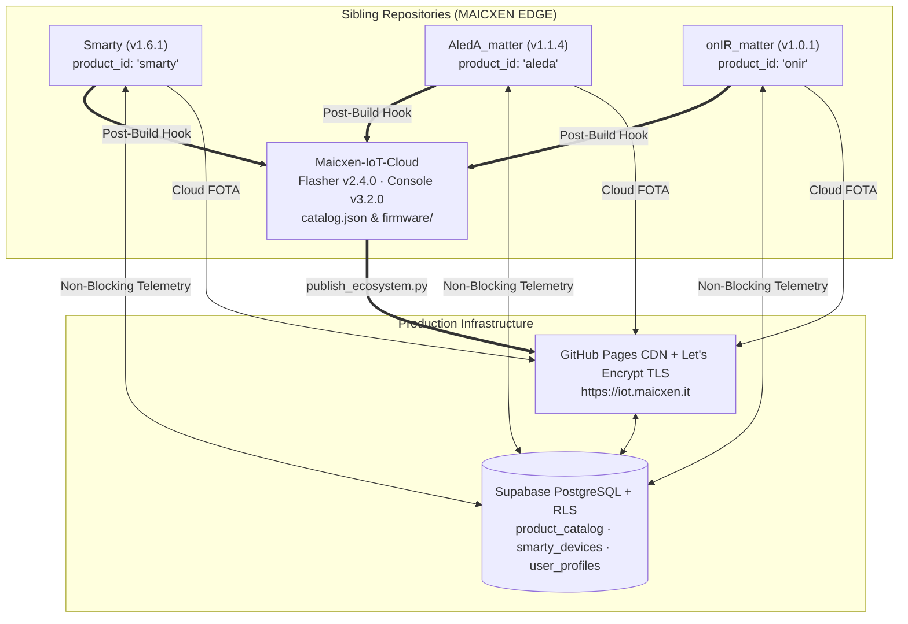

<div align="center">

# MAICXEN EDGE — Unified IoT Cloud, Web Flasher & Fleet Ecosystem

**Universal Web Flasher (`v2.4.0`) · Enterprise Fleet Console (`v3.2.0`) · Global OTA CDN · Supabase PostgreSQL + RLS**

[-0a84ff?style=for-the-badge&logo=googlechrome&logoColor=white)](https://iot.maicxen.it/)
[-2997ff?style=for-the-badge&logo=shield&logoColor=white)](https://iot.maicxen.it/dashboard/)
[](https://iot.maicxen.it/?product=smarty)
[](https://iot.maicxen.it/?product=aleda)
[](https://iot.maicxen.it/?product=onir)
[](https://supabase.com/)

*Engineered by **MAICXEN EDGE***

</div>

---

## Table of Contents

1. [Overview & Architectural Philosophy](#1-overview--architectural-philosophy)
2. [Decoupled Version Hierarchy](#2-decoupled-version-hierarchy)
3. [Multi-Repository Workspace Architecture](#3-multi-repository-workspace-architecture)
4. [DNS, TLS & Edge Routing (`iot.maicxen.it`)](#4-dns-tls--edge-routing-iotmaicxenit)
5. [Universal Web Flasher (`v2.4.0`)](#5-universal-web-flasher-v240)
6. [Enterprise Fleet Console (`v3.2.0`)](#6-enterprise-fleet-console-v320)
7. [Release Workflow & Product Integration](#7-release-workflow--product-integration)
8. [Directory Structure](#8-directory-structure)

---

## 1. Overview & Architectural Philosophy

`Maicxen-IoT-Cloud` is the centralized web flashing, fleet observability, and Over-The-Air (OTA) firmware distribution hub for every connected **MAICXEN EDGE** device.

### Local-First Control vs. Cloud Telemetry
- **Zero-Latency Local Control**: Real-time lighting, relay, and IR switching runs strictly locally via each device's embedded HTTP Web Server (`http://<wifi_ip>` or mDNS), physical/capacitive inputs, **Amazon Alexa**, or **Matter over Wi-Fi** (Apple Home, Google Home, Alexa).
- **Cloud Fleet Observability (`iot.maicxen.it/dashboard/`)**: Dedicated to non-blocking uptime/health telemetry, per-product firmware compliance, 1-click Local Web UI launch links, LAN discovery, catalog governance, and invite-only RBAC administration.

| Component | Version | Public Endpoint | Access | Role |
| :--- | :---: | :--- | :---: | :--- |
| **Universal Web Flasher** | **`v2.4.0`** | [`https://iot.maicxen.it/`](https://iot.maicxen.it/) | Public | Multi-product USB installer (`921,600` bps CRC-16/CCITT native USB-FOTA + `esptool-js` fallback) & live read-only USB diagnostics |
| **Enterprise Fleet Console** | **`v3.2.0`** | [`https://iot.maicxen.it/dashboard/`](https://iot.maicxen.it/dashboard/) | Invite-Only RBAC | Real-time telemetry monitoring, LAN IP probe, unified product catalog CRUD & user/ban administration |
| **Global Catalog Manifest** | Auto-synced | [`https://iot.maicxen.it/catalog.json`](https://iot.maicxen.it/catalog.json) | Public CDN | Machine-readable fallback manifest of platform versions, products, models & binary URLs |
| **Per-Model OTA Feeds** | Per Product | `https://iot.maicxen.it/firmware/<product>/<model>/version.json` | Public CDN | HTTPS update manifests polled by devices in the field during Cloud FOTA |

---

## 2. Decoupled Version Hierarchy

The ecosystem enforces three independent versioning layers:

| Layer | Identifier | Current Version | Active Models |
| :--- | :--- | :---: | :--- |
| **Web Flasher** | `FLASHER_VERSION` (`shared/js/config.js`) | **`v2.4.0`** | Browser WebSerial & `esptool-js` |
| **Fleet Console** | `DASHBOARD_VERSION` (`shared/js/config.js`) | **`v3.2.0`** | Supabase Realtime & RBAC |
| **Smarty** | `product_id: "smarty"` | **`v1.6.1`** | `esp32s3-std` (23×5 RGB Matrix) |
| **AledA** | `product_id: "aleda"` | **`v1.1.4`** | `esp32s3-matter` (Matter over Wi-Fi Controller) |
| **onIR** | `product_id: "onir"` | **`v1.0.1`** | `esp32-matter` (Universal IR Bridge) |

> **Unified Product Versioning Rule**: Every hardware model sharing a `product_id` carries the same unified product version while serving its own compiled binary under `/firmware/<product>/<model>/`. A PostgreSQL trigger (`on_product_catalog_sync_version`) on `public.product_catalog` enforces this automatically across Supabase and the Web Flasher.

---

## 3. Multi-Repository Workspace Architecture

```text
MAICXEN_EDGE_IOT/
├── MAICXEN_site/                  # Official website (Next.js 15 — maicxen.it)
├── Maicxen-IoT-Cloud/             # Web Flasher (v2.4.0), Fleet Console (v3.2.0) & OTA CDN
│   ├── index.html                 # Universal Web Flasher entry
│   ├── dashboard/index.html       # Enterprise Fleet Console entry
│   ├── catalog.json               # Global product/model manifest
│   ├── firmware/
│   │   ├── smarty/esp32s3-std/    # Smarty v1.6.1 binaries & version.json
│   │   ├── aleda/esp32s3-matter/  # AledA v1.1.4 Matter binaries & version.json
│   │   └── onir/esp32-matter/     # onIR v1.0.1 Matter binaries & version.json
│   └── scripts/
│       ├── publish_ecosystem.py   # Deploys hub & binaries to GitHub Pages (iot.maicxen.it)
│       └── register_release.py    # Universal CLI release integrator
├── Smarty/                        # Smarty ESP32-S3 firmware (v1.6.1) + PCB Gerbers
├── AledA_matter/                  # AledA ESP32-S3 Matter firmware (v1.1.4) + V3 PCB Gerbers
└── onIR_matter/                   # onIR ESP32 Matter IR Bridge firmware (v1.0.1)
```



---

## 4. DNS, TLS & Edge Routing (`iot.maicxen.it`)

- **DNS**: `CNAME` `iot` → `maicxen-studios.github.io.`
- **Edge Binding**: Native `CNAME` (`iot.maicxen.it`) on GitHub Pages Fastly Anycast CDN with enforced Let's Encrypt TLS (`https_enforced: true`).
- **Responsive UX**: Mobile-first safe-area support, `16px` input sizing on iOS Safari, and mobile bottom navigation in `/dashboard/`.

---

## 5. Universal Web Flasher (`v2.4.0`)

1. **Instant Non-Blocking Render**: Pre-seeded product cards render immediately and refresh dynamically from Supabase `public.product_catalog` (with automatic `./catalog.json` fallback). `esptool-js` is lazy-loaded only when Bootloader mode is required.
2. **Dual-Baud USB Auto-Discovery (`9600` & `115200` bps)**: Sends `\ntelemetry\n` with DTR/RTS safety guards, parses `product_id`, `model_id`, and `fw`, and auto-selects the matching hardware profile.
3. **Hybrid Dual-Mode Flashing**:
   - **Native High-Speed USB-FOTA (`921,600` bps + `CRC-16/CCITT`)** for devices reporting `serial_ota: true`.
   - **Automatic `esptool-js` Bootloader Fallback** (`eraseAll: false`) preserving Wi-Fi credentials and NVS counters on blank or recovery boards.
4. **Live Read-Only USB Telemetry**: Displays Hardware ID, Firmware & OTA slot, Operating State, Wi-Fi RSSI, Local Web UI URL, SoC Temperature, Free Heap RAM, and Session/Total Uptime.

---

## 6. Enterprise Fleet Console (`v3.2.0`)

- **Real-Time Fleet Monitoring**: Live Online/Offline status, power state, SoC temperature, heap telemetry, active OTA partition, and direct `Open Local UI ↗` links.
- **Unified Version Compliance**: Compares each unit's reported `fw` against its `product_id` target version (`1.6.1` Smarty, `1.1.4` AledA, `1.0.1` onIR).
- **Products & Catalog Admin**: Full CRUD management of product lines, hardware variants, capabilities, and unified product versions.
- **LAN Discovery**: Directly probes any local IPv4 address (`http://<ip>/api/status`) for instant local diagnostics.
- **Invite-Only RBAC (`Admin`, `Editor`, `Viewer`)**: Enforced via PostgreSQL triggers (`private.enforce_invite_only_signup()`), Row Level Security policies, ban controls, and audit logging.

---

## 7. Release Workflow & Product Integration

### Releasing a Firmware Update
1. Edit firmware in `Smarty/`, `AledA_matter/`, or `onIR_matter/` and update `FIRMWARE_VERSION` in `include/Config.h` + `version.json`.
2. Compile with PlatformIO (`pio run`). Each repo's `scripts/copy_firmware.py` post-build hook syncs binaries, `version.json`, and `catalog.json` into `../Maicxen-IoT-Cloud/`.
3. Update the product version in `https://iot.maicxen.it/dashboard/` → **Products & Catalog**.
4. Publish live to `https://iot.maicxen.it`:
   ```bash
   python3 Maicxen-IoT-Cloud/scripts/publish_ecosystem.py
   ```

### Integrating a New Product
1. Define `VENDOR_NAME = "MAICXEN EDGE"`, lowercase `PRODUCT_ID`, `MODEL_ID`, `FIRMWARE_VERSION`, and `FOTA_VERSION_URL` in `include/Config.h`.
2. Implement `POST /rest/v1/rpc/device_ingest_telemetry`, USB `telemetry\n` → `MAICXEN_TELEMETRY:<json>\n`, and local HTTP `GET /api/status`.
3. Register the build with `scripts/register_release.py <product_id> <model_id> <version> <build_dir> "<notes>"` and add the product in the Fleet Console.

---

## 8. Directory Structure

```text
Maicxen-IoT-Cloud/
├── index.html                        # Universal Web Flasher (v2.4.0)
├── catalog.json                      # Global ecosystem manifest
├── shared/
│   ├── css/tokens.css                # Design tokens & dark theme variables
│   └── js/
│       ├── config.js                 # Platform versions (2.4.0 / 3.2.0) & Supabase config
│       ├── version.js                # SemVer comparison & formatters
│       ├── pcb-visualizer.js         # Hardware illustration bridge
│       └── catalog-data.js           # Built-in product registry & Supabase loader
├── flasher/
│   ├── css/flasher.css
│   └── js/
│       ├── main.js                   # Flasher UI controller
│       ├── serial-protocol.js        # WebSerial probe, CRC-16 USB-FOTA & esptool-js fallback
│       └── usb-diagnostics.js        # Read-only live USB telemetry stream
├── dashboard/
│   ├── index.html                    # Enterprise Fleet Console (v3.2.0)
│   ├── css/dashboard.css
│   └── js/
│       ├── main.js                   # Bootstrap & tab routing
│       ├── supabase-client.js        # Shared Supabase client & state
│       ├── auth-rbac.js              # Invite-only auth & RBAC enforcement
│       ├── fleet-view.js             # KPI bar, device cards, LAN probe & Realtime
│       ├── catalog-manager.js        # Unified-version Product & Catalog CRUD
│       ├── activity-log.js           # Audit trail
│       └── user-profile-admin.js     # User roles, invites, bans & profile tools
├── firmware/
│   ├── smarty/esp32s3-std/           # Smarty v1.6.1
│   ├── aleda/esp32s3-matter/         # AledA v1.1.4
│   └── onir/esp32-matter/            # onIR v1.0.1
└── scripts/
    ├── publish_ecosystem.py          # GitHub Pages CDN publisher
    └── register_release.py           # PlatformIO release integrator
```

---

<div align="center">

**© 2026 MAICXEN EDGE — All Rights Reserved**  
[Web Flasher v2.4.0 (`iot.maicxen.it`)](https://iot.maicxen.it/) · [Fleet Console v3.2.0 (`iot.maicxen.it/dashboard/`)](https://iot.maicxen.it/dashboard/)

</div>
