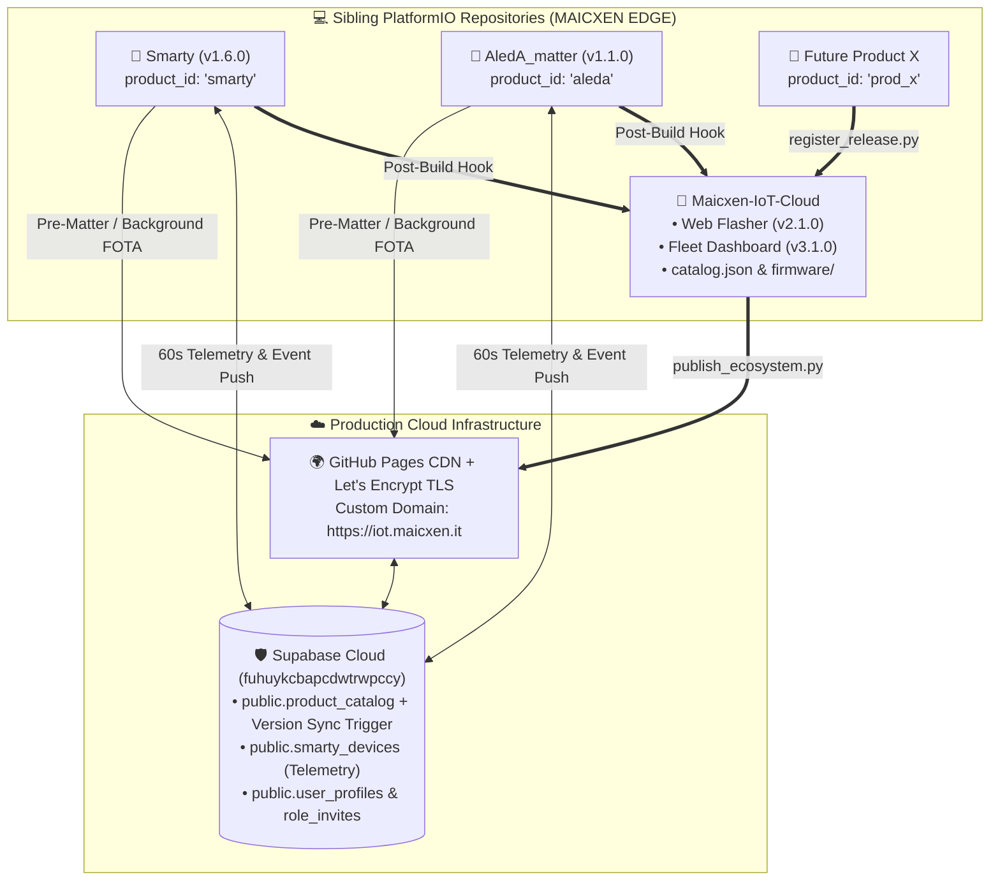

<div align="center">

# ⚡ MAICXEN EDGE — Unified IoT Cloud, Web Flasher & Fleet Ecosystem

**Multi-Product Universal Web Flasher (`v2.4.0`) · Enterprise Fleet Console (`v3.2.0`) · Global OTA Distribution CDN · Supabase PostgreSQL + RLS**

[-0a84ff?style=for-the-badge&logo=googlechrome&logoColor=white)](https://iot.maicxen.it/)
[-2997ff?style=for-the-badge&logo=shield&logoColor=white)](https://iot.maicxen.it/dashboard/)
[](https://iot.maicxen.it/?product=smarty)
[](https://iot.maicxen.it/?product=aleda)
[](https://iot.maicxen.it/?product=onir)
[](https://supabase.com/)

*Engineered by **MAICXEN EDGE***

</div>

---

## 📖 Table of Contents

1. [Ecosystem Overview & Architectural Philosophy](#-1-ecosystem-overview--architectural-philosophy)
2. [Decoupled Version Hierarchy (Platform vs. Products vs. Models)](#-2-decoupled-version-hierarchy-platform-vs-products-vs-models)
3. [Workspace & Multi-Repository Architecture](#-3-workspace--multi-repository-architecture)
4. [URL Routing, DNS (`iot.maicxen.it`) & Let's Encrypt TLS](#-4-url-routing-dns-iotmaicxenit--lets-encrypt-tls)
5. [Universal Web Flasher (`v2.1.0` — `https://iot.maicxen.it/`)](#-5-universal-web-flasher-v210--httpsiotmaicxenit)
6. [Enterprise Fleet Console (`v3.1.0` — `https://iot.maicxen.it/dashboard/`)](#-6-enterprise-fleet-console-v310--httpsiotmaicxenitdashboard)
7. [Step-by-Step Guide: Modifying Code & Releasing a Product Update](#-7-step-by-step-guide-modifying-code--releasing-a-product-update)
8. [Step-by-Step Guide: Adding a New Model/Variant to an Existing Product](#-8-step-by-step-guide-adding-a-new-modelvariant-to-an-existing-product)
9. [Step-by-Step Guide: Integrating a Brand-New Product into the Ecosystem](#-9-step-by-step-guide-integrating-a-brand-new-product-into-the-ecosystem)
10. [Directory Structure](#-10-directory-structure)

---

## 🚀 1. Ecosystem Overview & Architectural Philosophy

`Maicxen-IoT-Cloud` is the central web, cloud telemetry, and Over-The-Air (OTA) firmware distribution hub for all **MAICXEN EDGE** hardware products.

### Zero-Latency Control vs. Cloud Telemetry Separation
Rather than routing real-time light/relay switches through high-latency cloud polling queues, **MAICXEN EDGE** cleanly separates responsibilities:
- **Real-Time Device Control (Zero Latency)**: Performed locally via each product's embedded HTTP Web Server (`http://<wifi_ip>` or mDNS), physical buttons/capacitive touch, **Amazon Alexa**, or **Matter over Wi-Fi** (Apple Home, Google Home, Alexa).
- **Cloud Fleet Observability & Lifecycle (`iot.maicxen.it/dashboard/`)**: Dedicated to real-time fleet health, boot/uptime/on-time telemetry, per-product firmware version tracking, direct 1-click links to each device's Local Web UI, global catalog management, and invite-only RBAC user governance.

| Component | Current Version | Public URL | Access Level | Role |
| :--- | :---: | :--- | :---: | :--- |
| ⚡ **Universal Web Flasher** | **`v2.1.0`** | [`https://iot.maicxen.it/`](https://iot.maicxen.it/) | 🌍 Public | Multi-product USB firmware installer (`921600` bps native USB-FOTA + `esptool-js` bootloader fallback), stylized hardware PCB preview & read-only USB telemetry |
| 🛡️ **Enterprise Fleet Console** | **`v3.1.0`** | [`https://iot.maicxen.it/dashboard/`](https://iot.maicxen.it/dashboard/) | 🔒 Invite-Only RBAC | Real-time telemetry monitoring, Local UI launch links, LAN IP probe, unified product catalog & RBAC user/ban management |
| 📦 **Global Catalog Manifest** | Auto-synced | [`https://iot.maicxen.it/catalog.json`](https://iot.maicxen.it/catalog.json) | 🌍 Public CDN | Machine-readable fallback manifest of Web Flasher, Dashboard, product lines, hardware variants & firmware URLs |
| 🔄 **Per-Model OTA Endpoints** | Per Product | `https://iot.maicxen.it/firmware/<product>/<model>/version.json` | 🌍 Public CDN | Polled by ESP32-S3 units in the field for background Cloud FOTA updates |

---

## 🏷️ 2. Decoupled Version Hierarchy (Platform vs. Products vs. Models)

The ecosystem enforces **three strict, independent versioning layers**:

1. **Web Platform Versions (Independent of Firmware)**:
   - **Universal Web Flasher**: `v2.1.0` (`FLASHER_VERSION` in [`index.html`](file:///Users/maicxenstudios/Documents/PlatformIO/Projects/MAICXEN_EDGE_IOT/Maicxen-IoT-Cloud/index.html))
   - **Enterprise Fleet Console**: `v3.1.0` (`DASHBOARD_VERSION` in [`dashboard/index.html`](file:///Users/maicxenstudios/Documents/PlatformIO/Projects/MAICXEN_EDGE_IOT/Maicxen-IoT-Cloud/dashboard/index.html))
2. **Product Line Versions (Distinct per Product)**:
   - **Smarty** (`product_id: "smarty"`): **`v1.6.0`**
   - **AledA** (`product_id: "aleda"`): **`v1.1.0`**
3. **Model / Variant Rule (Unified Version, Distinct Binaries)**:
   - Every hardware model/variant under the same `product_id` **must share the exact same Product Version** while serving its own distinct compiled `firmware.bin` binary.
   - Example: Both **AledA Standard (`esp32s3-std`)** and **AledA Matter (`esp32s3-matter`)** carry **`v1.1.0`**, while pointing to `/firmware/aleda/esp32s3-std/firmware.bin` and `/firmware/aleda/esp32s3-matter/firmware.bin` respectively.
   - **Automatic Enforcement**: A PostgreSQL trigger (`on_product_catalog_sync_version` → `private.sync_product_version_across_models()`) on `public.product_catalog`, together with [`scripts/register_release.py`](file:///Users/maicxenstudios/Documents/PlatformIO/Projects/MAICXEN_EDGE_IOT/Maicxen-IoT-Cloud/scripts/register_release.py) and each firmware's `copy_firmware.py`, automatically synchronizes `latest_version` across every model sharing the same `product_id`.

---

## 🗂️ 3. Workspace & Multi-Repository Architecture

```text
/Users/maicxenstudios/Documents/PlatformIO/Projects/MAICXEN_EDGE_IOT/
│
├── 📁 Maicxen-IoT-Cloud/          🌐 [Web & OTA Hub -> https://iot.maicxen.it]
│   ├── index.html                 ──► Universal Web Flasher (v2.1.0)
│   ├── dashboard/index.html       ──► Enterprise Fleet Console (v3.1.0)
│   ├── catalog.json               ──► Global Product/Model/Version Manifest
│   ├── firmware/                  ──► CDN Binaries & version.json per <product>/<model>
│   │   ├── smarty/esp32s3-std/        (Smarty v1.6.0)
│   │   └── aleda/                     (AledA v1.1.0 across all variants)
│   │       ├── esp32s3-std/
│   │       └── esp32s3-matter/
│   └── scripts/
│       ├── publish_ecosystem.py   ──► Deploys Web Flasher, Dashboard & OTA CDN to GitHub Pages
│       └── register_release.py    ──► Universal CLI integrator for any PlatformIO project
│
├── 📁 Smarty/                     🔒 [Firmware Repo: Smarty 23×5 RGB Matrix (v1.6.0)]
│   ├── src/, include/, platformio.ini
│   └── scripts/copy_firmware.py   ──► Post-build hook syncing Smarty binaries to ../Maicxen-IoT-Cloud
│
├── 📁 AledA_matter/               🔒 [Firmware Repo: AledA Matter/Std ESP32-S3 (v1.1.0)]
│   ├── src/, include/, platformio.ini
│   └── scripts/copy_firmware.py   ──► Post-build hook syncing AledA binaries to ../Maicxen-IoT-Cloud
│
└── 📁 AledA/                      🕰️ [Legacy Prototype Archive (MQTT / v1 Hardware Reference)]
```



---

## 🌐 4. URL Routing, DNS (`iot.maicxen.it`) & Let's Encrypt TLS

- **DNS Record (`maicxen.it` Zone)**: `CNAME` host `iot` → `maicxen-studios.github.io.`
- **Native Edge Binding**: The deployed `CNAME` file (`iot.maicxen.it`) binds directly to GitHub Pages' Fastly Anycast CDN. The browser address bar remains on `https://iot.maicxen.it/...` with zero HTTP redirects or `<iframe>` masking.
- **Automated HTTPS / TLS**: Let's Encrypt SSL certificates are auto-provisioned and renewed by GitHub Pages with `"https_enforced": true`.
- **Responsive Mobile & Desktop UX**: Both the Web Flasher (`v2.1.0`) and Fleet Console (`v3.1.0`) include iOS Safari safe-area padding, `16px` minimum input fonts to prevent zoom, and a mobile bottom navigation bar in `/dashboard/`.

---

## ⚡ 5. Universal Web Flasher (`v2.1.0` — `https://iot.maicxen.it/`)

1. **Instant Non-Blocking Render & Live Catalog Sync**: Renders pre-seeded product cards immediately (`0 ms`), then dynamically refreshes from Supabase `public.product_catalog` (falling back cleanly to `./catalog.json`). `esptool-js` is lazy-loaded via dynamic `import()` only when Bootloader fallback mode is triggered.
2. **Dynamic Stylized Hardware PCB Visualizer**: Renders a vector SVG hardware PCB tailored to the active product (**Smarty** 23×5 Navy Matrix with 115 animated SMD LEDs & decoupling caps, **AledA V4** Dark-Blue Controller with 4 sky-blue relays, flyback diodes, ESP32-S3 antenna & screw terminals, or a generic **MAICXEN EDGE** board for new products). During flashing, the PCB animates live progress across its LEDs/relays.
3. **Dual-Baud USB Auto-Discovery (`9600` & `115200` bps)**: Probes connected boards cleanly (`\ntelemetry\n` with DTR/RTS safety guards and macOS CDC settle delays), reads `product_id`, `model_id`, and `fw`, and switches the UI to match the connected hardware automatically.
4. **Hybrid Dual-Mode Flashing**:
   - **Native High-Speed USB-FOTA (`921600` bps + `CRC-16/CCITT`)** for devices running `serial_ota: true` (`>= v1.5.0` Smarty / `>= v1.0.0` AledA).
   - **Automatic `esptool-js` Bootloader Fallback** (`eraseAll: false`, preserving saved Wi-Fi credentials and NVS counters) for factory-blank or legacy chips.
5. **Read-Only Live USB Telemetry**: Displays Hardware ID, Product, Firmware & OTA slot, Operating State, Wi-Fi RSSI, Local Web UI link (`http://<ip>`), Cloud Sync, SoC Temperature, Free Heap RAM, and Session/Total Uptime.

---

## 🛡️ 6. Enterprise Fleet Console (`v3.1.0` — `https://iot.maicxen.it/dashboard/`)

- **Read-Only Cloud Telemetry + Zero-Latency Local Launch**: Every device card and modal shows real-time status (`Online/Offline`, `Power`, temperature, heap RAM, uptime, cumulative on-time, active OTA partition) alongside a stylized PCB visual and a direct **`Open Local UI ↗`** (`http://<wifi_ip>`) button for instant zero-latency local control.
- **Unified Product Version Comparison**: Each device's `fw` is compared against its `product_id` unified target version (e.g., `1.6.0` for Smarty, `1.1.0` for any AledA model).
- **Products & Catalog Manager (`Admin`)**: Create, edit, and synchronize product lines, hardware variants, capabilities, and unified product versions across Supabase and the Web Flasher.
- **LAN Discovery (`LAN Discovery` tab)**: Probe any local IPv4 address (`http://<ip>/api/status`) directly from the local network to register or inspect telemetry immediately.
- **Strict Invite-Only RBAC (`Admin`, `Editor`, `Viewer`)**: Enforced by PostgreSQL triggers (`private.enforce_invite_only_signup()`), RLS policies, instant User Ban/Unban with custom ban reason, current-password verification, and Supabase Storage avatars.

---

## 🔄 7. Step-by-Step Guide: Modifying Code & Releasing a Product Update

### Workflow for **Smarty** or **AledA**
1. **Edit Firmware Code** in the product's PlatformIO workspace (`Smarty/` or `AledA_matter/`).
2. **Bump the Product Version** (SemVer `MAJOR.MINOR.PATCH`):
   - **For Smarty**: Update `FIRMWARE_VERSION` in [`Smarty/include/Config.h`](file:///Users/maicxenstudios/Documents/PlatformIO/Projects/MAICXEN_EDGE_IOT/Smarty/include/Config.h) and `"version"` + `"release_notes"` in [`Smarty/version.json`](file:///Users/maicxenstudios/Documents/PlatformIO/Projects/MAICXEN_EDGE_IOT/Smarty/version.json).
   - **For AledA**: Update `FIRMWARE_VERSION` in [`AledA_matter/include/Config.h`](file:///Users/maicxenstudios/Documents/PlatformIO/Projects/MAICXEN_EDGE_IOT/AledA_matter/include/Config.h) and [`AledA_matter/version.json`](file:///Users/maicxenstudios/Documents/PlatformIO/Projects/MAICXEN_EDGE_IOT/AledA_matter/version.json). All AledA models automatically receive this same unified version.
3. **Compile with PlatformIO**:
   ```bash
   cd /Users/maicxenstudios/Documents/PlatformIO/Projects/MAICXEN_EDGE_IOT/<Smarty|AledA_matter|onIR_matter>
   /Users/maicxenstudios/.platformio/penv/bin/pio run
   ```
   > The post-build script `scripts/copy_firmware.py` automatically copies `firmware.bin`, `bootloader.bin`, `partitions.bin`, `boot_app0.bin`, and `version.json` into `../Maicxen-IoT-Cloud/firmware/<product_id>/<model_id>/` and updates `catalog.json`.
4. **Synchronize Supabase `public.product_catalog`**:
   - Open `https://iot.maicxen.it/dashboard/` → **Products & Catalog**, click **Edit** on any model of that product, set the new **Product Version**, and click **Save Product / Variant to Cloud** (the database trigger automatically updates every model of that `product_id`).
5. **Deploy Web Hub & Binaries to `https://iot.maicxen.it`**:
   ```bash
   python3 /Users/maicxenstudios/Documents/PlatformIO/Projects/MAICXEN_EDGE_IOT/Maicxen-IoT-Cloud/scripts/publish_ecosystem.py
   ```
   Wait ~60 seconds for GitHub Pages CDN propagation. Existing devices in the field will automatically detect the new `version.json` on their next boot or 24-hour FOTA check.

### Workflow for Updating **Web Flasher** (`flasher/`) or **Fleet Dashboard** (`dashboard/`)
1. Edit only the relevant sector module (`shared/`, `flasher/`, or `dashboard/`). Shared styling/PCB graphics/version utilities live under `shared/` so improvements update both Web Flasher and Fleet Dashboard together.
2. Increment `FLASHER_VERSION` or `DASHBOARD_VERSION` in [`shared/js/config.js`](file:///Users/maicxenstudios/Documents/PlatformIO/Projects/MAICXEN_EDGE_IOT/Maicxen-IoT-Cloud/shared/js/config.js) + update the badges in `index.html` / `dashboard/index.html` and `catalog.json`.
3. Run `publish_ecosystem.py` (which recursively deploys `shared/`, `flasher/`, `dashboard/`, and `firmware/`) and commit `Maicxen-IoT-Cloud`.

---

## 🧩 8. Step-by-Step Guide: Adding a New Model/Variant to an Existing Product

Example: Adding `esp32s3-pro` under `aleda` (which is on `v1.1.0`):

1. **In Firmware**: Keep `PRODUCT_ID = "aleda"`, set `MODEL_ID = "esp32s3-pro"`, set `FIRMWARE_VERSION` to the **current unified product version** (`"1.1.0"`), and set:
   ```cpp
   constexpr const char* FOTA_VERSION_URL = "https://iot.maicxen.it/firmware/aleda/esp32s3-pro/version.json";
   ```
2. **Compile & Register Binaries**:
   ```bash
   pio run
   python3 /Users/maicxenstudios/Documents/PlatformIO/Projects/MAICXEN_EDGE_IOT/Maicxen-IoT-Cloud/scripts/register_release.py \
     aleda esp32s3-pro 1.1.0 /path/to/.pio/build/env_name "v1.1.0 — AledA Pro hardware binary"
   ```
   This creates `firmware/aleda/esp32s3-pro/{firmware,bootloader,partitions,boot_app0}.bin` + `version.json`, aligns `catalog.json`, and publishes to `iot.maicxen.it`.
3. **Register in Supabase Catalog**: Add `product_id: "aleda"`, `model_id: "esp32s3-pro"`, `latest_version: "1.1.0"` via the **Products & Catalog** tab in the Dashboard. Both `esp32s3-std`, `esp32s3-matter`, and `esp32s3-pro` will stay locked on the unified `aleda` product version while flashing separate binaries!

---

## 🌟 9. Step-by-Step Guide: Integrating a Brand-New Product into the Ecosystem

Example: Creating a new product **`PixNet`** (`product_id: "pixnet"`, starting at `v1.0.0`):

1. **Create a Sibling PlatformIO Project**: `/Users/maicxenstudios/Documents/PlatformIO/Projects/MAICXEN_EDGE_IOT/PixNet/`
2. **Conform to the MAICXEN EDGE Firmware Contract (`Config.h`)**:
   ```cpp
   constexpr const char* VENDOR_NAME       = "MAICXEN EDGE";
   constexpr const char* PRODUCT_ID        = "pixnet";
   constexpr const char* MODEL_ID          = "esp32s3-std";
   constexpr const char* PRODUCT_NAME      = "PixNet Controller";
   constexpr const char* FIRMWARE_VERSION  = "1.0.0";
   constexpr const char* HARDWARE_VERSION  = "1.0";
   constexpr const char* FOTA_VERSION_URL  = "https://iot.maicxen.it/firmware/pixnet/esp32s3-std/version.json";
   ```
3. **Conform to the Telemetry & USB Protocol Contract**:
   - **Cloud Telemetry (`POST /rest/v1/rpc/device_ingest_telemetry`)**: Include `hw_id`, `product_id`, `model_id`, `hw` (`hw_rev`), `mac`, `fw`, `ota_part`, `serial_ota`, `power`, `wifi_ssid`, `wifi_ip`, `rssi`, `temp`, `heap_free`, `heap_min`, `boot_count`, `uptime`, `total_on_sec`, `last_on_ts`, `last_off_ts`, `fota_status`.
   - **USB Serial Probe**: When receiving `"telemetry\n"` over USB Serial, print `MAICXEN_TELEMETRY:<json>\n`.
   - **Optional Native USB-FOTA**: Support `{"cmd":"serial_ota_start","size":...,"baud":921600}` framed `CRC-16/CCITT` streaming (otherwise `esptool-js` bootloader fallback works out of the box!).
   - **Local Embedded Web UI**: Serve a local control portal on port `:80` with `GET /api/status` returning the same telemetry JSON (enables `Open Local UI ↗` and **LAN Discovery**).
4. **Register & Publish**:
   - Add the new product in `/dashboard/` → **Products & Catalog**.
   - Run `scripts/register_release.py pixnet esp32s3-std 1.0.0 ../PixNet/.pio/build/esp32s3 "Initial v1.0.0 release"`.
   - *(Optional)* Add a custom stylized PCB SVG case `if (p === "pixnet")` inside [`shared/js/pcb-visualizer.js`](file:///Users/maicxenstudios/Documents/PlatformIO/Projects/MAICXEN_EDGE_IOT/Maicxen-IoT-Cloud/shared/js/pcb-visualizer.js) — one single edit automatically updates both Web Flasher and Fleet Dashboard (otherwise both display the generic MAICXEN EDGE ESP32-S3 PCB SVG).

---

## 📂 10. Directory Structure

```text
Maicxen-IoT-Cloud/
├── index.html                        # Entry HTML shell: Universal Web Flasher (v2.2.0)
├── catalog.json                      # Global ecosystem manifest (flasher, dashboard, products, models)
├── shared/                           # Shared modules & styles across Flasher and Dashboard
│   ├── css/tokens.css                # Design tokens, dark theme variables & mobile input rules
│   └── js/
│       ├── config.js                 # Platform versions, Supabase endpoints & USB-FOTA thresholds
│       ├── version.js                # SemVer comparison & date/duration formatters
│       ├── pcb-visualizer.js         # Unified SVG hardware PCB renderer (Smarty, AledA V4, future boards)
│       └── catalog-data.js           # Default catalog fallback & Supabase catalog loader
├── flasher/                          # Universal Web Flasher sector modules
│   ├── css/flasher.css               # Flasher layout, cards & mobile styles
│   └── js/
│       ├── main.js                   # Flasher UI controller, version check & workflow coordinator
│       ├── serial-protocol.js        # WebSerial probing, Native USB-FOTA CRC16 & esptool-js fallback
│       └── usb-diagnostics.js        # Live read-only USB Telemetry streaming controller
├── dashboard/                        # Enterprise Fleet Console (v3.1.0)
│   ├── index.html                    # Entry HTML shell
│   ├── css/dashboard.css             # Console layout, modal, tables & mobile bottom navigation
│   └── js/
│       ├── main.js                   # App bootstrap, tab routing, modal lifecycle & handlers
│       ├── supabase-client.js        # Shared Supabase client & reactive fleet state
│       ├── auth-rbac.js              # Invite-only Auth Gate, RBAC permissions & ban checks
│       ├── fleet-view.js             # KPI bar, filters, device cards, LAN probe & Realtime stream
│       ├── catalog-manager.js        # Unified-version Product & Catalog CRUD
│       ├── activity-log.js           # Audit activity log & Supabase sync
│       └── user-profile-admin.js     # Admin invite/role/ban table, avatar upload, password & JSON backup
├── firmware/
│   ├── smarty/esp32s3-std/           # Smarty v1.6.1 binaries & version.json
│   └── aleda/                        # AledA v1.1.1 Standard & Matter binaries + version.json
└── scripts/
    ├── publish_ecosystem.py          # Recursively deploys shared/, flasher/, dashboard/ & firmware/ to iot.maicxen.it
    └── register_release.py           # CLI integrator for any PlatformIO product/model build
```

---

<div align="center">

**© 2026 MAICXEN EDGE — All Rights Reserved**  
⚡ [Web Flasher v2.1.0 (`iot.maicxen.it`)](https://iot.maicxen.it/) · 🛡️ [Fleet Console v3.1.0 (`iot.maicxen.it/dashboard/`)](https://iot.maicxen.it/dashboard/)

</div>
